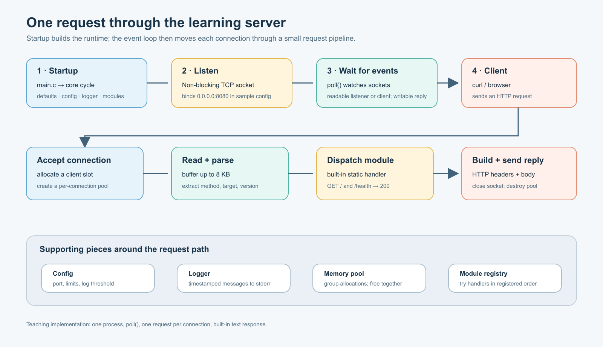
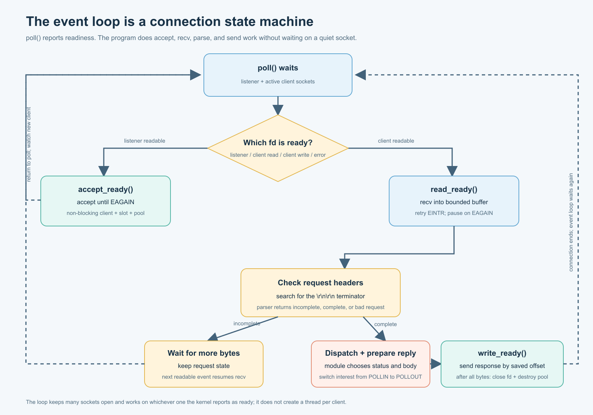
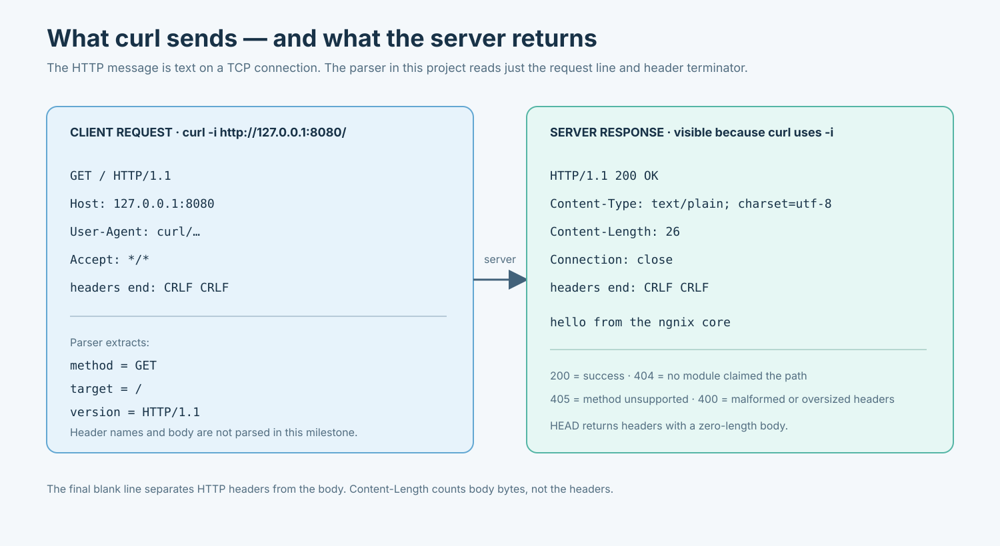
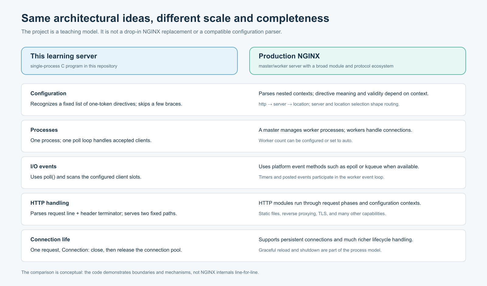

<p align="center">
  
</p>

<h1 align="center">fzgnix</h1>

<p align="center">A small HTTP server for learning how NGINX-style server architecture works.</p>

<p align="center">
  <a href="LICENSE">MIT License</a> · C · POSIX sockets · poll(2)
</p>

---

fzgnix is a from-scratch learning project that explores the core ideas behind NGINX, inspired by *Inside NGINX: High Performance Web Server Through Source Code*. It currently runs as one process with a non-blocking TCP listener and a `poll(2)` event loop. Startup initializes configuration, logging, and modules; each client connection moves through request parsing, module dispatch, response writing, and cleanup.

This is a teaching implementation. It is not a production web server, a drop-in NGINX replacement, or a compatible NGINX configuration parser.

## Get the book

Read *Inside NGINX: High Performance Web Server Through Source Code* on [Amazon](https://www.amazon.in/INSIDE-NGINX-Performance-Server-Through-ebook/dp/B0GSSM84VC). To request the free version, [fill out this form](https://docs.google.com/forms/d/e/1FAIpQLSejZNPKEe944prpC5X0mKJly4-IrpL1XyRryA1ajF7WnH82Sw/viewform?usp=header).

## Architecture

The server starts its core cycle, opens a listener, then moves each ready connection through a compact HTTP request pipeline.

<p align="center">
  
</p>

The event loop is a connection state machine: it waits for socket readiness, accepts or reads available data, and switches a completed response to writable events.

<p align="center">
  
</p>

The HTTP exchange diagram shows the request and response lifecycle handled by the current implementation.

<p align="center">
  
</p>

## fzgnix and production NGINX

fzgnix demonstrates a few architectural ideas in a compact codebase. Production NGINX has a much broader configuration model, process architecture, event backends, protocol support, and module ecosystem.

<p align="center">
  
</p>

| Area | fzgnix | Production NGINX |
| --- | --- | --- |
| Configuration | Small subset of one-token directives | Nested contexts with context-dependent directives and routing |
| Processes | One process handles accepted clients | Master and worker process model |
| I/O events | `poll()` scans configured client slots | Platform event backends such as epoll or kqueue |
| HTTP handling | Parses request line and headers; serves `/` and `/health` | HTTP phases and modules for static files, proxying, TLS, and more |
| Connection life | One request, then close and release the connection pool | Persistent connections and richer lifecycle handling |

## Current features

- Configurable TCP listen port and client connection limit
- Non-blocking IPv4 sockets and a single-process `poll(2)` event loop
- Incremental HTTP/1.x header parsing with an 8 KiB request buffer
- `GET` and `HEAD` support for `/` and `/health`
- `400`, `404`, and `405` responses
- Per-connection memory pools, partial response writes, and timestamped logging
- Module registry and a small NGINX-inspired configuration subset

The `root` setting is parsed but static-file serving is not implemented yet. Each connection handles one request and then closes.

## Build and run

Requirements: a C11 compiler, `make`, and a POSIX-compatible environment.

```sh
make
./ngnix -c ngnix.conf
```

The server listens on `0.0.0.0:8080` by default. In another terminal, try:

```sh
curl -i http://127.0.0.1:8080/
curl -i http://127.0.0.1:8080/health
```

Press Ctrl-C to stop the server. The configuration file accepts a small subset of NGINX-style directives; see [`ngnix.conf`](ngnix.conf).

## Source layout

| Path | Purpose |
| --- | --- |
| `src/core` | Startup cycle, config subset, memory pool, logger, and module registry |
| `src/event` | `poll(2)` backend and connection state machine |
| `src/http` | HTTP request parsing and built-in response module |
| `src/os/unix` | Unix socket setup and non-blocking descriptor helpers |

See [ARCHITECTURE.md](ARCHITECTURE.md) for a component walkthrough and [ROADMAP.md](ROADMAP.md) for planned milestones.

## License

fzgnix is released under the [MIT License](LICENSE).
